


 

 

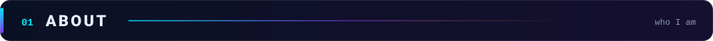

 

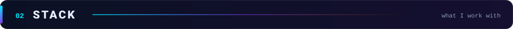
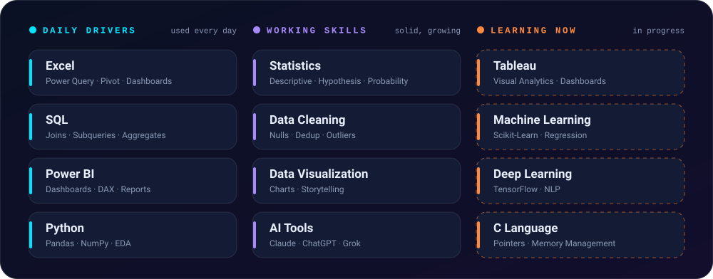

 

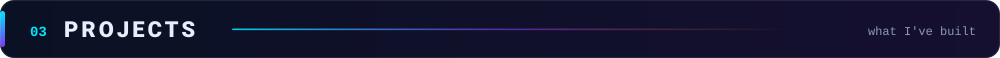


<a href="https://imysunny.github.io/Track-My-Job/">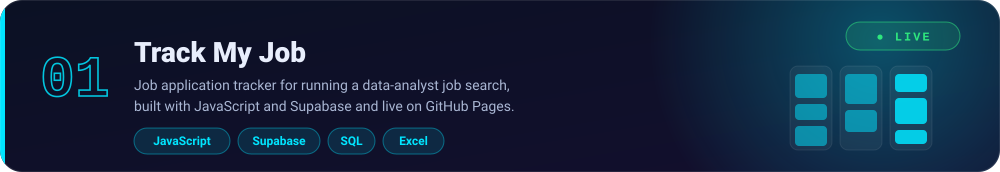</a>

<a href="https://imysunny.github.io/Track-My-Job/">Live app</a> · <a href="https://github.com/IMYSUNNY/Track-My-Job">Source code</a>

<a href="https://github.com/IMYSUNNY/Excel-Sale-Dashboard">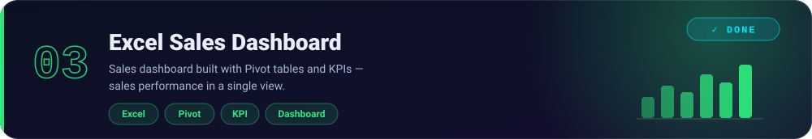</a>

<a href="https://github.com/IMYSUNNY/Excel-Sale-Dashboard">Source code</a>

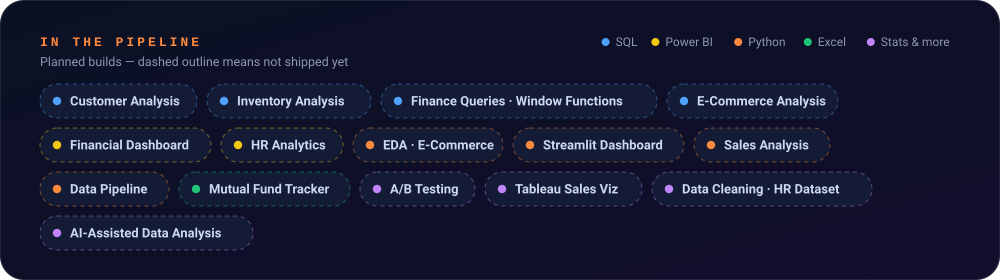

 


 

- [x] Get real-world financial data experience
- [x] Build the Excel Sales Dashboard (Project 01)
- [x] Launch the portfolio website — [imysunny.github.io](https://imysunny.github.io)
<!-- Add the rest of your 2026 goals here, one per line: - [ ] Goal -->

 

**Open to Data Analyst roles in BFSI / Fintech — and always up for a conversation about data.**

  

